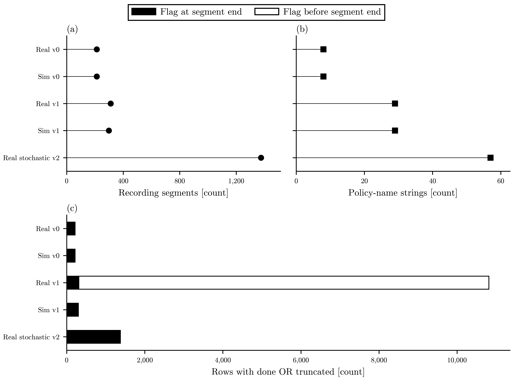

# Sim-to-Real Controller Ranking

Can dispersion in the predicted performance difference between controllers,
across physically justified models consistent with development data, identify
rankings that should be withheld? The corrected-source qualification loads all
15 evaluation policies on synthetic inputs, but reproduces a first-crash loader
failure. The corrected-v2 Drive census now establishes archive identity and
recording boundaries. A source-pinned reward bridge now executes candidate
simulator steps, and a full development trace exposes the frozen checkpoint
timing defect. The published Groundtruth aggregates are now reproduced from
the corrected archive. ZIP terms and historical simulator identity remain
unverified, so reference ranking stays closed.

[](https://github.com/500ft/sim-to-real-controller-ranking/actions/workflows/ci.yml)
[](LICENSE)

[Results](#results) · [Roadmap](ROADMAP.md) · [Quick start](#quick-start) ·
[Qualification report](reports/ope_qualification.md) · [History](docs/history/README.md)



Historical census at the original source pins. F110 archives, structural census of unfiltered records; episode meaning and policy execution are unresolved. Real stochastic v2 has the most recording segments (1,375); archives hold 8 to 57 policy-name strings each; Real v1 alone raises flags before a segment ends (10,502 rows). Panel (a): recording segments per archive (circles). Panel (b): exact policy-name strings per archive (squares). Panel (c): rows with done OR truncated, each counted once and split into flags at a segment end (filled) and before a segment end (hollow). All count axes are linear and start at zero. Per archive, with flagged rows as at end + before end: Real v0 213 segments, 8 names, 213 + 0 flagged rows; Sim v0 213 segments, 8 names, 213 + 0 flagged rows; Real v1 311 segments, 29 names, 311 + 10,502 flagged rows; Sim v1 298 segments, 29 names, 298 + 0 flagged rows; Real stochastic v2 1,375 segments, 57 names, 1,375 + 0 flagged rows. Resets do not establish independent episodes, and name matches do not establish executable policies. Counts only; no return or ranking analysis. Archive filenames and sources: runs/ope_qualification/structure.md. Source: runs/ope_qualification/result.json.
[Caption file](reports/figures/ope_structure.caption.md) ·
[Accessible tables and archive identities](runs/ope_qualification/structure.md) ·
[SVG](reports/figures/ope_structure.svg).

## Results

The [corrected-source interface report](reports/ope_interface_qualification.md)
and [executed result](runs/ope_interface_qualification/result.json) record the
new source pins, license inspection, policy batch checks and loader failure.
The [corrected-v2 result](reports/ope_corrected_v2.md) binds the separate Drive
objects by ID and hash, establishes recording boundaries and reports policy
coverage, terminal exclusions and original-loader sensitivity. The
[per-agent reward aggregates](runs/ope_corrected_v2/reward_aggregates.json) use
one frozen calculation on both archives; the [reference comparison](runs/ope_corrected_v2/reference_comparison.json)
shows the remaining reward mismatch. No controller ranking was run.
The [source-class trace](runs/ope_corrected_v2/reward_trace.json) isolates a
stored-reward cutoff difference in a small sample and reproduces the duplicate
full-lap checkpoint on synthetic input. The [candidate simulator probe](runs/ope_corrected_v2/simulator_probe.json)
reaches reset with pinned compatibility aliases, then fails on its first step.
The later [reward bridge result](reports/ope_reward_adapter_qualification.md)
retains that failure, executes a bounded simulator smoke, and compares the
registered reward variants on the same eligible development recordings.
The [Groundtruth reconciliation](reports/ope_groundtruth_reconciliation.md)
reproduces all published per-agent aggregates under one registered variant;
the [result](runs/ope_groundtruth_reconciliation/result.json) lists which
agents match under each of the 20 variants.

A [candidate correction](reports/ope_interface_qualification.md#separate-correction-qualification)
passes all 16,380 registered synthetic dtype cases; the original helper fails
4,094. [Source result](runs/ope_terminal_filter_qualification/result.json).
The adopted development rule was applied to the corrected archives only after
their recording boundaries were established.

The preserved census below uses the earlier pins:

- Real v1 contains 311 recording segments and 29 distinct policy-name strings.
  Its 10,813 `done | truncated` rows cannot be treated as separate recordings.
- Real stochastic v2 contains 1,375 segments and 57 policy-name strings. All
  those names match configuration filenames in the pinned benchmark source;
  execution on archived observations remains unqualified.
- At those earlier pins, both real-stochastic registrations loaded the
  simulation-v1 archive. The corrected source now uses distinct Drive objects.
  The original qualification binds each inspected archive by filename, hash
  and internal array root.

The [executed table](runs/ope_qualification/structure.md) and
[qualification report](reports/ope_qualification.md) give the source pins,
method, policy-name discrepancies and separate gates for FQE and probability-ratio
estimators. [result.json](runs/ope_qualification/result.json) is the source for
structural numbers; the table and plot are generated views.

## Quick start

The structural reader uses Python 3.11 in its own environment. Unit checks need
no archive download, upstream policy package or vehicle:

```bash
python3.11 -m venv .venv-ope
source .venv-ope/bin/activate
python -m pip install -r requirements-ope-qualification.txt
python experiments/test_ope_qualification.py
```

The optional integration test is skipped unless the pinned cache is supplied.
See [reproduction](reports/ope_qualification.md#reproduce) for the executed
archive check and figure commands. Source data and third-party code are kept
outside this repository while reuse terms remain unknown.

## What's next

Choose the development reward definition, qualify policy execution on
archived observations, and obtain explicit corrected-ZIP terms.
The [roadmap](ROADMAP.md) keeps ranking, M3 and reserved evaluation closed
until their gates pass.

## Retained work

The licensed [public-driving comparison](reports/real_command_response.md)
remains a same-run development result. Its
[split qualification](reports/driving_split_qualification.md) admitted no
separate final group. Unopened bags stay unopened.

The [history index](docs/history/README.md) retains simulator identification,
controller comparisons, mast hand calculations, FEA, useful CAD and calibration
tooling. Same-model simulator consistency does not validate real controller
rankings. Mast mounting and physical scope remain pending; this software pivot
approves no deck design, height, fabrication or physical campaign.

## Documentation

| Document | Purpose |
| --- | --- |
| [Roadmap](ROADMAP.md) | Finish line and current stop condition |
| [Qualification report](reports/ope_qualification.md) | Executed structural result and estimator gates |
| [Corrected-v2 local result](reports/ope_corrected_v2.md) | Drive archive census, reward aggregates and current stop condition |
| [Open questions](docs/OPEN_QUESTIONS.md) | Current unknowns and superseded questions |
| [Reading and reproduction guide](docs/START_HERE.md) | Environments and retained checks |
| [Data and figures](docs/data-and-figures.md) | Current and historical figure provenance |
| [History](docs/history/README.md) | Preserved driving, simulation and mechanical work |

## Contributing

Read [CONTRIBUTING.md](CONTRIBUTING.md) and [AGENTS.md](AGENTS.md). A pull request
must identify the result it changes and the checks actually run.

## License and attribution

Repository code uses the [MIT License](LICENSE), preserving upstream simulator
attribution. This grants no rights to the separately inspected F110 archives or
policy code. The [artifact-level source inspection](reports/ope_interface_qualification.md#inspected-sources-and-rights)
verifies upstream code licenses; corrected ZIP permission remains unresolved. The earlier
public-driving bag has its own [CC BY 4.0 source record](runs/real_command_response/source.json).
See the [source register](docs/upstream_roboracer_sources.md) and
[identity note](docs/REPOSITORY_IDENTITY.md) for the retained project history.
