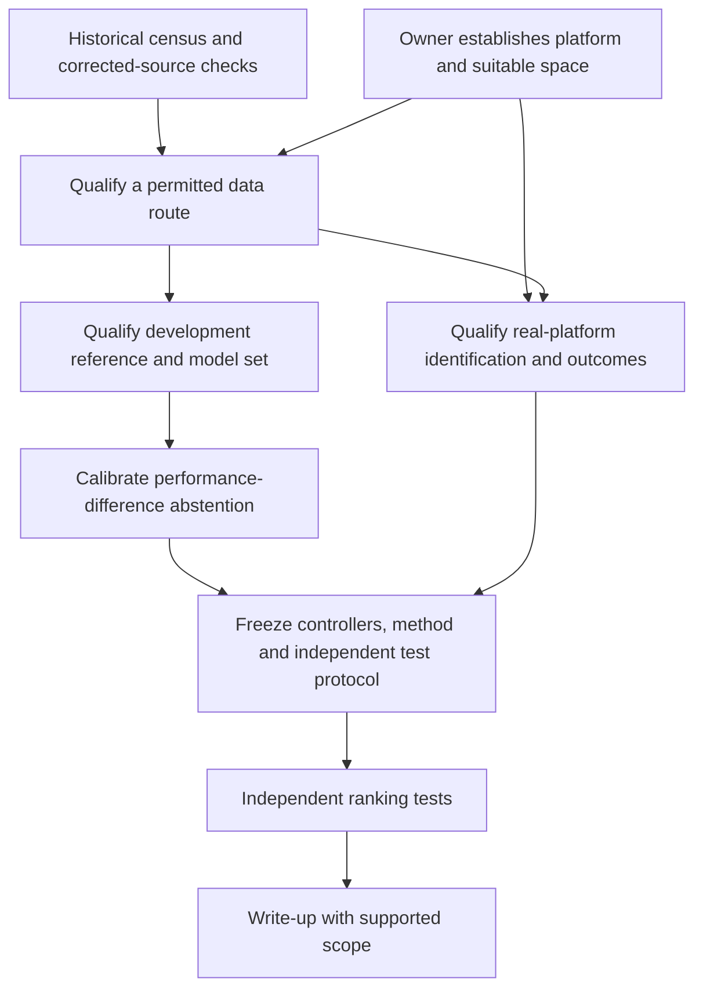

# Roadmap

## Question and finish line

Can dispersion in the predicted performance difference between controllers,
across physically justified vehicle models consistent with development data,
identify rankings that will reverse on a real platform?

Finish with an independently evaluated rule for selecting a controller or
abstaining. Report ranking errors, harmful choices avoided, the fraction of
comparisons retained and the additional real tests required. Compare methods
at matched retention and account for near ties and uncertainty in the observed
performance difference. A result confined to ranking flips between our own
simulators cannot establish real-platform usefulness.

The owner adopted this dependency plan and repository cleanup. Future
milestones describe prerequisites and completion evidence; adoption does not
authorize data exposure, a research campaign, purchases or external contact.
[Open questions](docs/OPEN_QUESTIONS.md) records those decisions separately.

## Verified starting point

The [historical structural census](reports/ope_qualification.md) preserves
archive hashes, internal roots, recording boundaries and policy-name matches at
the earlier pins. Its [result](runs/ope_qualification/result.json) and
[generated table](runs/ope_qualification/structure.md) include the old
wrong-alias registrations. They do not qualify the corrected ZIPs.

The [corrected-source interface run](reports/ope_interface_qualification.md)
executes synthetic policy and loader cases. A [separate correction qualification](reports/ope_interface_qualification.md#separate-correction-qualification)
qualifies a candidate final-sentinel correction on its registered synthetic
domain. The [corrected Drive-v2 census](reports/ope_corrected_v2.md) now binds
both objects by ID and hash, establishes recording boundaries and applies the
adopted development exclusion. It records policy coverage, stored log-density
availability and original-loader sensitivity. Common-reward aggregates are
published for local qualification. The [development reward trace](reports/ope_reward_adapter_qualification.md)
now identifies the frozen checkpoint row-alignment defect and compares reward
variants on one eligible cohort. A source-pinned local bridge executes candidate
simulator steps and passes a short reward-alignment smoke. Published Groundtruth
membership and exact generating revision remain unknown. ZIP rights
and the historical simulator revision remain open. These results supply no
controller-performance or refusal claim.

The owner adopted qualification before the conditionally authorized reference
ranking. Resolve the common-reward discrepancy and candidate compatibility
before M2 ranking. Preserve the reserved groups for independent evaluation.

The licensed [command-response study](reports/real_command_response.md) remains
development evidence. Its [split qualification](reports/driving_split_qualification.md)
admitted no independent final group. Unopened bags remain unassigned and frozen.

## Dependency order

Dataset permission and platform access are parallel routes to evidence.
Qualified existing physical data can support the real-platform branch without
a new car. Owner-approved acquisition can supply a different route if public
data remains unusable. One author's refusal closes that source route; it does
not establish that no legitimate route exists. The accepted-assumption route now permits local census and reward
qualification; empirical ranking still depends on their results.

## Milestones and completion evidence

### M1. Qualify an accessible data route

Status: current. Local census executed and reward qualification incomplete under the
[four accepted research assumptions](docs/OPEN_QUESTIONS.md#four-accepted-research-assumptions).
ZIP rights and historical simulator identity remain unverified.
Prerequisite: the historical census and a clearly identified corrected source.

- Obtain terms covering the corrected data ZIPs and intended derived outputs.
  The [contact record](docs/ope_author_request.txt) records the full reply supplied
  by the owner and inspected in this session. It describes code-license additions
  but supplies no explicit Drive-ZIP terms. The corrected-source run verifies
  those public code licenses. The accepted assumptions permit local qualification without claiming a
  third-party grant. Keep raw and processed data outside git and distribution.
- Confirm the benchmark's simulator revision. The simulator is public and
  licensed, but the benchmark has no gitlink for it. The registered public
  candidate fails with the pinned loader's effective nested reward signature.
  The [local reward bridge](reports/ope_reward_adapter_qualification.md)
  executes a bounded public-start smoke with the candidate physics and four
  checked common reward contributions. Historical identity remains open. The
  candidate terminal-helper correction
  was applied after recording boundaries were established, with a private
  exclusion ledger and original-loader sensitivity result. Do not infer
  physical crash truth from a terminal flag.
- The [corrected ZIP census](runs/ope_corrected_v2/census.json) pins both Drive
  objects and records structural results. The [local result report](reports/ope_corrected_v2.md)
  records exclusions and original-loader sensitivity. The earlier archive
  census remains historical.
- Resolve raw segment versus episode meaning, continuing terminal flags,
  truncation, exclusions, vehicle/session groups and real/simulation pairing.
- The evaluation policy names occur in both corrected archives, and stored
  two-component log densities are finite. Map those names to executable
  implementations on archived observations, including clipping, state and reset
  behavior. The [frozen shared calculation](runs/ope_corrected_v2/protocol.json)
  produces per-agent aggregates for all four rewards. The
  [whole-development trace](runs/ope_reward_adapter_qualification/development_trace.json)
  checks matching records and isolates checkpoint timing, stored cutoff rows
  and source-class behavior. The published Groundtruth cohort is unidentified,
  so its aggregate gap remains open. Simulation lacks `new_rewards`.
- The [candidate interface probe](runs/ope_corrected_v2/simulator_probe.json)
  preserves the failed unmodified step. A [pinned-call witness](runs/ope_reward_adapter_qualification/source_call_witness.json)
  identifies the live signature and progress indexing fault. The local bridge
  passes registered synthetic cases and a [bounded smoke](runs/ope_reward_adapter_qualification/smoke.json).
  Qualify recorded-observation policy execution and benchmark provenance before
  development ranking.
- Keep FQE target-action execution and coverage separate from IS/WIS/ratio-based
  DR joint-density and support requirements. Never fill missing probabilities
  with constants. Clarify the unresolved helper source named in the report.

Complete for local development when: disclosed source-use assumptions, corrected archive identity, episode/group
mapping, a tested policy interface and a common reward support a declared use,
with explicit exclusions and estimator eligibility. If a route fails, record
that reason and let the owner choose another source or stop; do not inspect
reserved outcomes to rescue it.

### M2. Qualify a development reference and model set

Status: conditionally owner-authorized for the published evaluation agents'
simulation-versus-real reference ranking, waiting on M1 reward and simulator qualification. Prerequisite: qualified
local-use assumptions, corrected archive and policy interfaces, a qualified common reward
and the pinned candidate environment with its historical-identity limitation. Commit the comparison rules below before
reading performance outcomes; this does not authorize M3 or M5 data use.

- The owner accepted the [development comparison direction](docs/OPEN_QUESTIONS.md#accepted-development-comparison-direction)
  for accessible records. Before inspecting performance outcomes, freeze the
  exact seed list, timestep, common reward code, discount, start distribution,
  terminal and truncation handling, aggregation and whole-record uncertainty.
  Do not infer paired episode IDs from a shared-start description.
- Reproduce a reference calculation with independently checked boundary cases.
  Check units, frames, clocks, observations and action conventions before fitting.
- Fit model parameters on development groups only. Retain model discrepancies,
  exclusions and identification uncertainty.
- Introduce parameter and structural variants only with physical justification
  and a declared validity domain. An ensemble cannot guarantee that omitted
  physics is covered.

Complete when: reference computations reproduce, parameters have source support,
model variants have stated assumptions, and separate identification, calibration
and reserved evaluation groups are established without outcome leakage.

### M3. Calibrate a controller-difference abstention rule

Status: future. Prerequisite: M2, qualified candidate controllers and an approved
development protocol.

- Compute each controller pair's performance difference on the same model and
  scenario, then summarize dispersion across the justified model set. Do not
  substitute separate absolute-performance spreads for paired differences.
- Define the direction of preference, a justified near-tie region and how
  uncertain reference outcomes enter scoring before calibration.
- Calibrate abstention using development/calibration groups. Compare fit
  residuals, out-of-distribution indicators, parameter uncertainty, simple
  ensemble disagreement, nominal simulation and whole-run uncertainty.
- Inspect SPOTA as candidate prior work or a baseline for applicability before
  choosing an implementation. Its name establishes no estimator eligibility.
  Include FQE and probability-ratio methods only where their distinct gates pass.

Complete when: a frozen candidate rule and eligible baselines report ranking
error versus retained comparisons, near-tie handling and measurement cost on
calibration groups. If simpler coverage explains the benefit, withdraw the claim
of added value from model disagreement. All-comparison refusal is not success.

Retained from the owner-directed literature review.
Sources: [prior work note](literature/prior-work-ranking-withholding.md).

- Confidence-gate baseline. Use the nominal model alone. Predict each pair's
  performance difference with a bootstrap interval over rollouts and withhold
  when the interval covers zero. Compare the dispersion rule against this
  baseline at matched withhold rate. Pre-registered success criterion: the
  dispersion rule beats the baseline at matched coverage. If it does not, that
  is the reported result.
- Registered prediction. The 15 published agents split into 4 lidar-reactive
  follow-the-gap agents without localisation and 11 pose-dependent pure-pursuit
  agents. Simulator-versus-real disagreements are predicted to concentrate in
  cross-family pairs. If the dispersion rule flags only within-family pairs,
  it is blind to the main mechanism in the data.
- Scope limit. The author confirms one car and configuration, and recalls a
  recording span of a few days without session IDs. The claim is limited to
  ranking flips on the same car.
  Transfer to an unseen vehicle is not tested.

### M4. Establish real-platform evidence

Status: optional access route, currently blocked for new physical acquisition.
Prerequisites: owner-confirmed platform and suitable test-space access with
permission for physical work, or an M1-qualified existing physical dataset.
Self-funded equipment and independently arranged space can qualify when their
actual setup supports the required measurements. Acquisition and method
preparation can proceed independently only when separately authorized.

- Confirm repeatable operating conditions, sensor/action interfaces and the
  measurements needed to identify the chosen model and performance difference.
- Use independent identification and calibration groups; record actual vehicle,
  track, configuration and shared-session dependencies.
- Qualify repeatability, outcome uncertainty and data sufficiency before
  selecting a confirmatory sample. A proposed run count is not a sample-size
  justification.

Complete when: permitted real-platform records support identification and the
chosen outcome, with defensible independent groups and usable uncertainty.
Building or possessing a car alone does not complete this milestone.

### M5. Freeze and execute independent ranking tests

Status: future; independent evaluation remains unauthorized.
Prerequisites: M3 and M4, qualified independent groups, named reviewer and
explicit approval of the test protocol.

- Freeze controllers, model variants, fitted parameters, abstention thresholds,
  baselines, tie rules, exclusions and metrics before final outcomes are opened.
- Justify test coverage and sample size from the intended comparison and
  observed variation; prevent shared sessions from being counted as independent.
- Evaluate the frozen methods on reserved whole groups. Record ranking errors,
  abstentions and extra real tests needed, including failures and exclusions.
  Changes informed by final outcomes require a new independent evaluation.

Complete when: a reviewer can reproduce the frozen comparison and distinguish
real-platform performance, inadequate evidence and assumption-dependent results.
Unopened driving bags retain their existing roles unless a new qualified split
is approved before exposure.

### M6. Write up the supported result

Status: future. Prerequisite: M5, or a documented stop at an earlier gate.

Complete when: the report traces claims to permitted sources, reproduces the
comparison and states the scope of any negative result or inability to evaluate.
Keep measured rank reversal separate from simulation-only behavior. Publication
and external sharing require the owner's separate decision.

## Retained work and owner-held decisions

The [history index](docs/history/README.md) retains useful simulation baselines,
original FEA results with their corrections, protected CAD generators/contracts,
calibration tools and frozen evidence. Retired fabrication instructions and
planning checkers are removed from active use.

D2 mounting and physical-study scope, K2 disposition of the earlier driving
study, fleet access/adoption, funding, purchases, naming, reviewer and publication
remain unresolved. No mast result constitutes success for the current question.
The delegated low-mount assessment remains provisional; no height or deck design
is approved. Static stiffness cannot establish modal or vibration performance.
