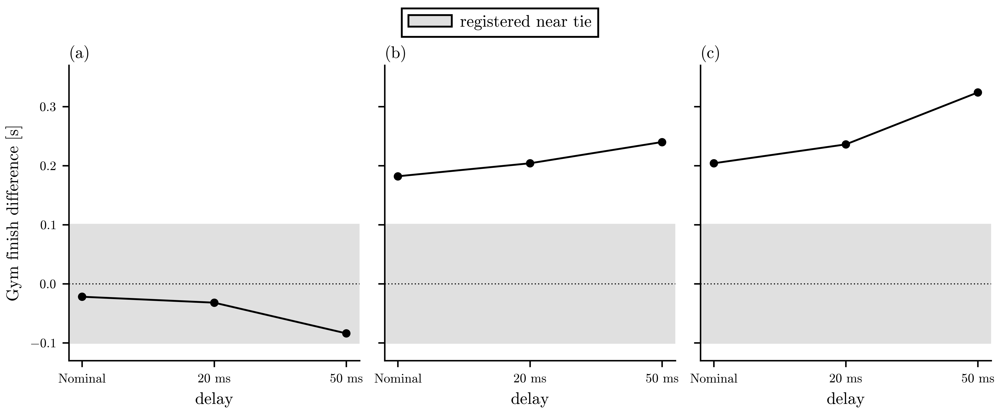
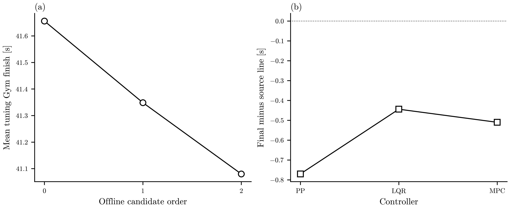
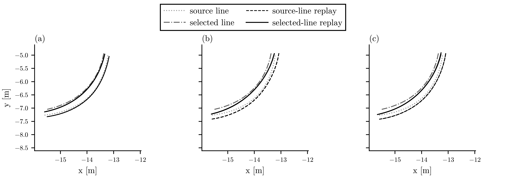
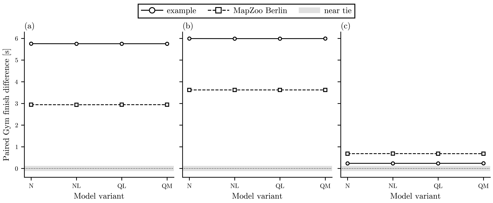

# Simulation controller pipeline

The example-track legacy replay reproduces the recorded Gym finish times. Constrained target-speed lines support development runs on that map and the distinct, pinned public MapZoo Berlin map. The original installed map set supplies no second ordered line.

## Source and method

[Frozen protocol](../runs/controller_pipeline/protocol.json), [constrained-line protocol](../runs/controller_pipeline/constrained_run_protocol.json), [tuning protocol](../runs/controller_pipeline/tuning_constrained_protocol.json), [line qualification](../runs/controller_pipeline/line_qualification.json) and [map inventory](../runs/controller_pipeline/protocol.json) bind source files, settings and selection rules. The old claimed simulator revision could not be retrieved. Checked-in simulator and example bytes match the separately verified MIT upstream candidate in the protocol. This reproduces the checked-in setup, without establishing the historical Git revision. All traces are simulator output.

The planner reads the native semicolon waypoint columns. Geometry checks cover closure, ordering, self-intersection, tangent/curvature and the sampled expanded vehicle perimeter against the map raster using its declared origin and resolution. The source geometry passes. Its speed schedule exceeds the registered lateral and forward target limits. The derived arc-length line meets those target profile limits; actual vehicle acceleration and controller timing are reported separately. The derived line is a speed-profile replacement on the same geometry, not a new track.

The [initial geometry-only qualification](../runs/controller_pipeline/line_qualification_initial.json) omitted the source-speed check. The corrected result retains that record. Three exploratory legacy-line LQR tuning runs ([candidate 0](../runs/controller_pipeline/tune0_nominal_lqr.json), [1](../runs/controller_pipeline/tune1_nominal_lqr.json), [2](../runs/controller_pipeline/tune2_nominal_lqr.json)) were stopped at that finding and excluded from the constrained cohort.

Gym's finish rule requires later checkpoint visits. A first forward geometric crossing occurs earlier than the reported Gym finish; both are retained in each run JSON. The source Gym code requires four near-start toggles and the completed legacy traces show lap_count 2 at termination. The tables below use Gym finish time, not a one-circuit crossing time.

## Map coverage

| Map | Line status | Ordered line |
| --- | --- | --- |
| berlin | excluded: no ordered source line; map raster alone does not select a unique closed loop | none |
| example | geometry qualified; source speed exceeds limits | [source](../examples/example_waypoints.csv) |
| levine | excluded: no ordered source line; map raster alone does not select a unique closed loop | none |
| skirk | excluded: no ordered source line; map raster alone does not select a unique closed loop | none |
| stata_basement | excluded: no ordered source line; map raster alone does not select a unique closed loop | none |
| vegas | excluded: no ordered source line; map raster alone does not select a unique closed loop | none |
| MapZoo Berlin (public expansion) | source geometry qualified; derived target speed qualified | [source and line](../runs/controller_pipeline/mapzoo_berlin/qualification.json) |

Five installed maps lack a qualified ordered line. Levine's YAML also names a missing PNG. The raster alone cannot resolve loop order or junction choices. No line was invented for those maps. The separately sourced MapZoo Berlin line expands the development cohort; it is not the installed Gym Berlin map.

## Legacy source-line replay

| Controller | Run | Status | Gym finish [s] | RMS distance [m] | Max CTE [m] | Steering effort [rad] | p95 / max compute [ms] | Deadline misses | Source |
| --- | --- | --- | ---: | ---: | ---: | ---: | ---: | ---: | --- |
| PP | baseline pure pursuit | completed_lap | 38.042 | 0.1579 | 0.4031 | 8.199 | 0.16 / 6.21 | 0 | [JSON](../runs/controller_pipeline/baseline_nominal_pure_pursuit.json) |
| LQR | baseline lqr | completed_lap | 38.064 | 0.1786 | 0.4977 | 8.988 | 0.25 / 6.21 | 0 | [JSON](../runs/controller_pipeline/baseline_nominal_lqr.json) |
| MPC | baseline mpc | completed_lap | 37.860 | 0.1692 | 0.4767 | 8.677 | 2.86 / 27.44 | 22 | [JSON](../runs/controller_pipeline/baseline_nominal_mpc.json) |

The [synchronized video](../runs/controller_pipeline/example_controller_overlay.mp4) uses each 2 ms telemetry stream directly. [Preview](../runs/controller_pipeline/example_controller_preview.png). Its colors and marker shapes distinguish controllers; time, map axes and terminal states remain visible.

## Constrained target-speed line

| Controller | Run | Status | Gym finish [s] | RMS distance [m] | Max CTE [m] | Steering effort [rad] | p95 / max compute [ms] | Deadline misses | Source |
| --- | --- | --- | ---: | ---: | ---: | ---: | ---: | ---: | --- |
| PP | constrained60 pure pursuit | completed_lap | 49.286 | 0.0843 | 0.3680 | 12.270 | 0.15 / 8.55 | 0 | [JSON](../runs/controller_pipeline/constrained60_nominal_pure_pursuit.json) |
| LQR | constrained lqr | completed_lap | 43.492 | 0.1220 | 0.4127 | 10.916 | 0.23 / 11.47 | 1 | [JSON](../runs/controller_pipeline/constrained_nominal_lqr.json) |
| MPC | constrained mpc | completed_lap | 43.124 | 0.1208 | 0.3906 | 11.073 | 2.00 / 27.72 | 10 | [JSON](../runs/controller_pipeline/constrained_nominal_mpc.json) |
| PP | constrained pure pursuit | max_steps | NA | 0.0856 | 0.3680 | 11.303 | 0.15 / 17.69 | 1 | [JSON](../runs/controller_pipeline/constrained_nominal_pure_pursuit.json) |

The original 45 s PP run was truncated. Its [registered horizon amendment](../runs/controller_pipeline/constrained60_amendment.json) kept the completed LQR/MPC traces and reran PP to a 60 s upper horizon. Source target-speed limits do not certify closed-loop acceleration or real-time MPC execution.

## Equal-budget offline tuning

| Controller | Run | Status | Gym finish [s] | RMS distance [m] | Max CTE [m] | Steering effort [rad] | p95 / max compute [ms] | Deadline misses | Source |
| --- | --- | --- | ---: | ---: | ---: | ---: | ---: | ---: | --- |
| PP | ctune0 pure pursuit | completed_lap | 49.240 | 0.0828 | 0.6180 | 14.022 | 0.14 / 5.97 | 0 | [JSON](../runs/controller_pipeline/ctune0_nominal_pure_pursuit.json) |
| PP | ctune1 pure pursuit | completed_lap | 49.292 | 0.0966 | 0.6180 | 12.652 | 0.15 / 10.17 | 1 | [JSON](../runs/controller_pipeline/ctune1_nominal_pure_pursuit.json) |
| PP | ctune2 pure pursuit | completed_lap | 49.372 | 0.1205 | 0.6180 | 11.152 | 0.16 / 7.21 | 0 | [JSON](../runs/controller_pipeline/ctune2_nominal_pure_pursuit.json) |
| LQR | ctune0 lqr | completed_lap | 43.486 | 0.1300 | 0.6180 | 11.089 | 0.22 / 5.84 | 0 | [JSON](../runs/controller_pipeline/ctune0_nominal_lqr.json) |
| LQR | ctune1 lqr | completed_lap | 43.504 | 0.1338 | 0.6180 | 11.334 | 0.24 / 14.19 | 1 | [JSON](../runs/controller_pipeline/ctune1_nominal_lqr.json) |
| LQR | ctune2 lqr | completed_lap | 43.538 | 0.1414 | 0.6180 | 11.681 | 0.23 / 10.64 | 1 | [JSON](../runs/controller_pipeline/ctune2_nominal_lqr.json) |
| MPC | ctune0 mpc | completed_lap | 43.242 | 0.1301 | 0.6180 | 11.338 | 1.94 / 21.79 | 9 | [JSON](../runs/controller_pipeline/ctune0_nominal_mpc.json) |
| MPC | ctune1 mpc | completed_lap | 43.170 | 0.1314 | 0.6180 | 11.382 | 2.58 / 31.98 | 23 | [JSON](../runs/controller_pipeline/ctune1_nominal_mpc.json) |
| MPC | ctune2 mpc | completed_lap | 43.132 | 0.1323 | 0.6180 | 11.406 | 2.86 / 34.86 | 21 | [JSON](../runs/controller_pipeline/ctune2_nominal_mpc.json) |

Selections were frozen in [frozen_constrained_selection.json](../runs/controller_pipeline/frozen_constrained_selection.json) before zero-offset evaluation.

## Frozen zero-offset evaluation

| Controller | Run | Status | Gym finish [s] | RMS distance [m] | Max CTE [m] | Steering effort [rad] | p95 / max compute [ms] | Deadline misses | Source |
| --- | --- | --- | ---: | ---: | ---: | ---: | ---: | ---: | --- |
| PP | ceval pure pursuit | completed_lap | 49.230 | 0.0688 | 0.3680 | 13.338 | 0.15 / 8.23 | 0 | [JSON](../runs/controller_pipeline/ceval_nominal_pure_pursuit.json) |
| LQR | ceval lqr | completed_lap | 43.474 | 0.1179 | 0.4122 | 10.669 | 0.24 / 9.96 | 0 | [JSON](../runs/controller_pipeline/ceval_nominal_lqr.json) |
| MPC | ceval mpc | completed_lap | 43.238 | 0.1192 | 0.3694 | 11.067 | 1.91 / 44.45 | 11 | [JSON](../runs/controller_pipeline/ceval_nominal_mpc.json) |

## Same-track controller-tuning comparison

| Controller | Prior constrained Gym finish [s] | Frozen evaluation [s] | Change [s] | RMS distance change [m] |
| --- | ---: | ---: | ---: | ---: |
| PP | 49.286 | 49.230 | -0.056 | -0.0156 |
| LQR | 43.492 | 43.474 | -0.018 | -0.0041 |
| MPC | 43.124 | 43.238 | +0.114 | -0.0016 |

The frozen search minimized tracking distance on offset starts, not lap time. The zero-offset evaluation reduced RMS distance for each controller; MPC's Gym finish became slower. These example-track tuning runs alone establish no line-optimization or multi-track speed-improvement claim.

## Delay sensitivity on the legacy line



One example-track simulation with fixed nominal physics and source-listed command delays. Panels (a), (b), (c) show PP minus LQR, PP minus MPC, and LQR minus MPC. The shaded region is the registered ±0.1 s near-tie interval, not uncertainty. All three pairs completed in every scenario; none reversed outside that interval. Source: runs/controller_pipeline/delay_sensitivity.json. The delay values are perturbation assumptions, not an identified model distribution.
[Caption file](figures/controller_delay_sensitivity.caption.md) · [SVG](figures/controller_delay_sensitivity.svg) · [source differences](../runs/controller_pipeline/delay_sensitivity.json).

## Public MapZoo Berlin development track

[Pinned source and license](../third_party/mapzoo_berlin/SOURCE.json), [prospective run protocol](../runs/controller_pipeline/mapzoo_berlin/expansion_protocol.json), [line qualification](../runs/controller_pipeline/mapzoo_berlin/qualification.json) and [frozen selection](../runs/controller_pipeline/mapzoo_berlin/frozen_selection.json) bind the map, derived speed profile and equal-budget controller tuning. All three controllers completed a lap without collision on the source corridor.

| Controller | Run | Status | Gym finish [s] | RMS distance [m] | Max CTE [m] | Steering effort [rad] | p95 / max compute [ms] | Deadline misses | Source |
| --- | --- | --- | ---: | ---: | ---: | ---: | ---: | ---: | --- |
| PP | baseline pure pursuit | completed_lap | 43.902 | 0.0775 | 0.1513 | 14.734 | 0.10 / 2.45 | 0 | [JSON](../runs/controller_pipeline/mapzoo_berlin/baseline_pure_pursuit.json) |
| LQR | baseline lqr | completed_lap | 40.926 | 0.1085 | 0.2162 | 13.594 | 0.23 / 5.36 | 0 | [JSON](../runs/controller_pipeline/mapzoo_berlin/baseline_lqr.json) |
| MPC | baseline mpc | completed_lap | 40.178 | 0.1074 | 0.1917 | 13.524 | 2.55 / 23.76 | 13 | [JSON](../runs/controller_pipeline/mapzoo_berlin/baseline_mpc.json) |
| PP | evaluation pure pursuit | completed_lap | 43.840 | 0.0611 | 0.1168 | 16.214 | 0.14 / 5.90 | 0 | [JSON](../runs/controller_pipeline/mapzoo_berlin/evaluation_pure_pursuit.json) |
| LQR | evaluation lqr | completed_lap | 40.898 | 0.1035 | 0.2090 | 13.372 | 0.23 / 7.75 | 0 | [JSON](../runs/controller_pipeline/mapzoo_berlin/evaluation_lqr.json) |
| MPC | evaluation mpc | completed_lap | 40.216 | 0.1062 | 0.1796 | 13.414 | 1.66 / 20.93 | 7 | [JSON](../runs/controller_pipeline/mapzoo_berlin/evaluation_mpc.json) |

[Synchronized simulation video](../runs/controller_pipeline/mapzoo_berlin/controller_overlay.mp4) and [preview](../runs/controller_pipeline/mapzoo_berlin/controller_preview.png) sample the three telemetry streams directly. The MPC frozen evaluation is slower than its untuned baseline; every run is retained.

### Registered controller tuning

| Controller | Run | Status | Gym finish [s] | RMS distance [m] | Max CTE [m] | Steering effort [rad] | p95 / max compute [ms] | Deadline misses | Source |
| --- | --- | --- | ---: | ---: | ---: | ---: | ---: | ---: | --- |
| PP | tune0 pure pursuit | completed_lap | 43.846 | 0.0673 | 0.2500 | 16.861 | 0.14 / 9.43 | 0 | [JSON](../runs/controller_pipeline/mapzoo_berlin/tune0_pure_pursuit.json) |
| PP | tune1 pure pursuit | completed_lap | 43.906 | 0.0831 | 0.2686 | 15.139 | 0.15 / 11.85 | 1 | [JSON](../runs/controller_pipeline/mapzoo_berlin/tune1_pure_pursuit.json) |
| PP | tune2 pure pursuit | completed_lap | 43.984 | 0.1090 | 0.3073 | 13.069 | 0.10 / 8.83 | 0 | [JSON](../runs/controller_pipeline/mapzoo_berlin/tune2_pure_pursuit.json) |
| LQR | tune0 lqr | completed_lap | 40.902 | 0.1091 | 0.3348 | 13.791 | 0.23 / 7.84 | 0 | [JSON](../runs/controller_pipeline/mapzoo_berlin/tune0_lqr.json) |
| LQR | tune1 lqr | completed_lap | 40.926 | 0.1137 | 0.3325 | 13.992 | 0.23 / 4.41 | 0 | [JSON](../runs/controller_pipeline/mapzoo_berlin/tune1_lqr.json) |
| LQR | tune2 lqr | completed_lap | 40.982 | 0.1223 | 0.3319 | 14.260 | 0.24 / 8.08 | 0 | [JSON](../runs/controller_pipeline/mapzoo_berlin/tune2_lqr.json) |
| MPC | tune0 mpc | completed_lap | 40.220 | 0.1108 | 0.2857 | 13.756 | 2.01 / 20.90 | 12 | [JSON](../runs/controller_pipeline/mapzoo_berlin/tune0_mpc.json) |
| MPC | tune1 mpc | completed_lap | 40.202 | 0.1117 | 0.2963 | 13.892 | 2.19 / 23.36 | 8 | [JSON](../runs/controller_pipeline/mapzoo_berlin/tune1_mpc.json) |
| MPC | tune2 mpc | completed_lap | 40.188 | 0.1123 | 0.3022 | 13.910 | 2.93 / 26.94 | 20 | [JSON](../runs/controller_pipeline/mapzoo_berlin/tune2_mpc.json) |

Each controller received three configurations on the same offset start. The minimum eligible independent RMS distance selected the frozen configuration, before the zero-offset evaluation above.

## Frozen offline line comparison

The [prospective smoothing protocol](../runs/controller_pipeline/mapzoo_berlin/offline_line_protocol.json) defines a periodic quadratic second-difference objective, then checks actual curvature, map clearance and the speed profile on each exported line. The objective is an approximation to smoothness, not exact minimum curvature. Every line receives the same three-setting controller budget on a shared world start. The source line and every candidate remain in the ledger.

| Candidate order | Smoothness weight | Mean tuning Gym finish [s] | All controllers completed | Source |
| ---: | ---: | ---: | --- | --- |
| 0 | 0 | 41.656 | yes | [candidate](../runs/controller_pipeline/mapzoo_berlin/offline_frozen_choice.json) |
| 1 | 1000 | 41.349 | yes | [candidate](../runs/controller_pipeline/mapzoo_berlin/offline_frozen_choice.json) |
| 2 | 3000 | 41.080 | yes | [candidate](../runs/controller_pipeline/mapzoo_berlin/offline_frozen_choice.json) |

The [selected line and controller settings](../runs/controller_pipeline/mapzoo_berlin/offline_frozen_choice.json) were frozen before zero-offset evaluation.

| Controller | Source-line evaluation [s] | Selected-line evaluation [s] | Change [s] | Status |
| --- | ---: | ---: | ---: | --- |
| PP | 43.840 | 43.070 | -0.770 | completed_lap |
| LQR | 40.898 | 40.454 | -0.444 | completed_lap |
| MPC | 40.216 | 39.706 | -0.510 | completed_lap |

| Controller | Selected-line max speed [m/s] | Max speed × yaw-rate proxy [m/s²] | Max absolute longitudinal acceleration [m/s²] | Deadline misses |
| --- | ---: | ---: | ---: | ---: |
| PP | 8.000 | 9.788 | 9.510 | 0 |
| LQR | 8.528 | 13.974 | 9.510 | 0 |
| MPC | 8.822 | 13.481 | 9.510 | 6 |

The target line passes its 4 m/s² lateral and 2 m/s² forward speed-profile limits, but all three closed-loop runs exceed those values in the telemetry's speed × yaw-rate proxy and longitudinal acceleration. LQR and MPC also exceed the 8 m/s target speed cap. The lateral proxy omits lateral-velocity derivative, so it is not a complete body acceleration measurement. The faster Gym times are retained as constraint-failing development observations, not an accepted speed-optimization result. The MPC also misses its 10 ms compute deadline in the ideal-time replay.



MapZoo Berlin simulation development. Panel (a): mean Gym finish of the three independently selected controllers on each registered line candidate, in candidate order (0, 1000, 3000 smoothing weights). Panel (b): one frozen zero-offset evaluation per controller on the chosen line minus its earlier frozen source-line evaluation. Negative values are faster; all three final runs exceed the registered 4 m/s² target in the speed-times-yaw-rate proxy, so speed improvement is not qualified. Source: runs/controller_pipeline/mapzoo_berlin/offline_frozen_choice.json and the linked evaluation JSONs.
[SVG](figures/controller_offline_progress.svg) · [caption](figures/controller_offline_progress.caption.md).



MapZoo Berlin simulated x-y positions sampled from the retained 2 ms telemetry without invented interpolation. Panels (a), (b), (c) are PP, LQR and MPC, zoomed to the largest nearest-point line displacement. Dotted and dash-dot are the source and selected lines; dashed and solid are the earlier frozen source-line evaluation and selected-line evaluation on the same world start. The selected line passed footprint clearance and target speed-profile checks, but the speed-times-yaw-rate proxy in every selected-line run exceeded the registered target. Source: per-run compressed telemetry under runs/controller_pipeline/mapzoo_berlin/.
[SVG](figures/controller_offline_overlay.svg) · [caption](figures/controller_offline_overlay.caption.md).

## Paired model sensitivity

The [frozen model set](../runs/controller_pipeline/model_sensitivity_protocol.json) uses paired stiffness fits from prior synthetic identification. These are labeled simulation assumptions, not a measured joint uncertainty distribution. The noise and quantization labels describe the earlier fit conditions; this replay changes stiffness only and injects no observation noise. Each controller pair shares the map, line, start, seed and model; collisions have no invented lap time.

| Track | Model | Pair | Gym finish difference [s] | Near tie | Reversal outside tie |
| --- | --- | --- | ---: | --- | --- |
| example | nominal | PP minus LQR | +5.756 | no | no |
| example | noise_low | PP minus LQR | +5.754 | no | no |
| example | quantization_low | PP minus LQR | +5.754 | no | no |
| example | quantization_medium | PP minus LQR | +5.754 | no | no |
| example | nominal | PP minus MPC | +5.992 | no | no |
| example | noise_low | PP minus MPC | +5.990 | no | no |
| example | quantization_low | PP minus MPC | +5.990 | no | no |
| example | quantization_medium | PP minus MPC | +5.992 | no | no |
| example | nominal | LQR minus MPC | +0.236 | no | no |
| example | noise_low | LQR minus MPC | +0.236 | no | no |
| example | quantization_low | LQR minus MPC | +0.236 | no | no |
| example | quantization_medium | LQR minus MPC | +0.238 | no | no |
| mapzoo_berlin | nominal | PP minus LQR | +2.942 | no | no |
| mapzoo_berlin | noise_low | PP minus LQR | +2.938 | no | no |
| mapzoo_berlin | quantization_low | PP minus LQR | +2.942 | no | no |
| mapzoo_berlin | quantization_medium | PP minus LQR | +2.942 | no | no |
| mapzoo_berlin | nominal | PP minus MPC | +3.624 | no | no |
| mapzoo_berlin | noise_low | PP minus MPC | +3.624 | no | no |
| mapzoo_berlin | quantization_low | PP minus MPC | +3.624 | no | no |
| mapzoo_berlin | quantization_medium | PP minus MPC | +3.624 | no | no |
| mapzoo_berlin | nominal | LQR minus MPC | +0.682 | no | no |
| mapzoo_berlin | noise_low | LQR minus MPC | +0.686 | no | no |
| mapzoo_berlin | quantization_low | LQR minus MPC | +0.682 | no | no |
| mapzoo_berlin | quantization_medium | LQR minus MPC | +0.682 | no | no |

The largest signed-pair change from nominal is 0.004 s; 0 registered comparisons reverse outside the near-tie region. Gym finish is resolved on the 2 ms integration grid, so these small changes do not establish general robustness. [Source differences](../runs/controller_pipeline/model_sensitivity/summary.json).



Development simulation only. Panels (a), (b), (c) show PP minus LQR, PP minus MPC and LQR minus MPC Gym finish time. N, NL, QL, QM are nominal, noise-low, quantization-low and quantization-medium paired stiffness fits from prior synthetic identification. They are deterministic sensitivity assumptions, not physical uncertainty draws. The grey ±0.1 s band is the registered near-tie region, not a confidence interval. Source: runs/controller_pipeline/model_sensitivity/summary.json.
[SVG](figures/controller_model_dispersion.svg) · [caption](figures/controller_model_dispersion.caption.md).

## Reproduce

Use the repository's Python 3.9 Gym environment from `environment.yml`. The commands below read checked-in example and licensed public MapZoo assets; no driving archive is accessed.

```bash
export PYTHONPATH=gym:.
python -m unittest roboracer.test_reference_line -v
python experiments/controller_pipeline.py qualify
python experiments/controller_pipeline.py baseline
python experiments/controller_pipeline.py constrained_baseline
python experiments/controller_pipeline.py constrained60_pp
python experiments/controller_pipeline.py sensitivity
python experiments/controller_dispersion.py
python experiments/controller_pipeline.py tune_constrained
python experiments/controller_pipeline.py freeze_constrained
python experiments/controller_pipeline.py evaluate_constrained
python experiments/controller_video.py
python -m experiments.prepare_mapzoo_berlin
python -m experiments.run_mapzoo_berlin baseline
python -m experiments.run_mapzoo_berlin tune
python -m experiments.run_mapzoo_berlin freeze
python -m experiments.run_mapzoo_berlin evaluate
python experiments/controller_video.py --track mapzoo_berlin
python -m experiments.mapzoo_offline_line prepare
python -m experiments.mapzoo_offline_line tune
python -m experiments.mapzoo_offline_line freeze
python -m experiments.mapzoo_offline_line evaluate
python -m experiments.controller_model_sensitivity pilot
python -m experiments.controller_model_sensitivity nominal
python -m experiments.controller_model_sensitivity variants
python -m experiments.controller_model_sensitivity analyze
python experiments/controller_multitrack_figures.py
python experiments/controller_pipeline_report.py
```

Run order matters: the frozen protocol and line artifact must exist before simulation, and selection must be frozen before evaluation. Video and plot generators read committed telemetry/JSON. Per-run compressed telemetry, source hashes and full metrics are in [runs/controller_pipeline](../runs/controller_pipeline/protocol.json).

## Remaining gate

The original five map exclusions remain. A measured joint vehicle-model region and compute-delay-aware execution are absent, so the paired variants are development sensitivity only. The paper's M2, M3 and reserved cases remain closed.
