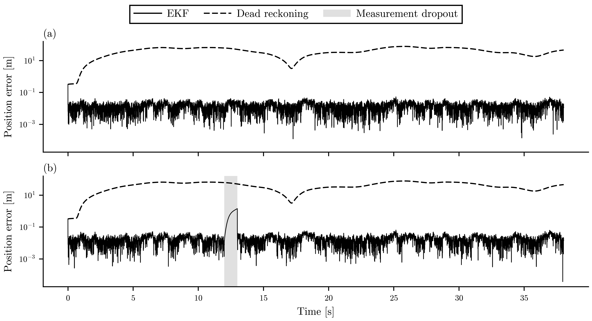
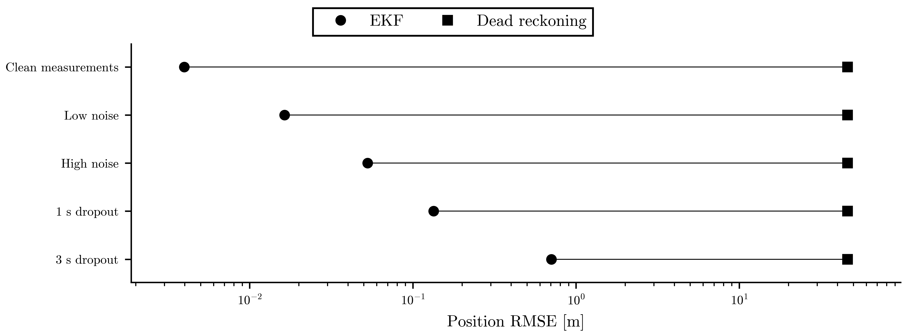
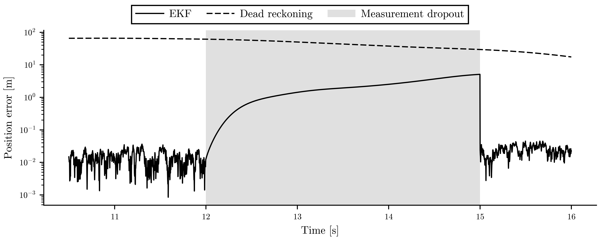

# EKF Study

## Objective

Compare dead reckoning and EKF estimates against Gym ground truth under reproducible measurement noise and dropout.

## Setup

- Integration timestep: `0.002 s`
- Controller update rate: `100 Hz`
- Seed: `42`
- EKF state: `['x_m', 'y_m', 'theta_rad', 'speed_mps', 'yaw_rate_radps']`
- EKF process covariance diagonal: `[2e-05, 2e-05, 5e-06, 0.0002, 0.0002]`

## Results

| scenario | estimator | position_rmse_m | max_position_error_m | theta_rmse_rad | ekf_position_rmse_improvement_fraction |
| --- | --- | --- | --- | --- | --- |
| clean_measurements | dead_reckoning | 46.1019 | 77.0896 | 2.35197 | 0.999914 |
| clean_measurements | ekf | 0.00397259 | 0.320156 | 0.000580246 | 0.999914 |
| dropout_1s | dead_reckoning | 46.1019 | 77.0896 | 2.35197 | 0.997094 |
| dropout_1s | ekf | 0.133975 | 1.41835 | 0.00615537 | 0.997094 |
| dropout_3s | dead_reckoning | 46.1019 | 77.0896 | 2.35197 | 0.98469 |
| dropout_3s | ekf | 0.705808 | 5.07754 | 0.0666775 | 0.98469 |
| high_noise | dead_reckoning | 46.1019 | 77.0896 | 2.35197 | 0.998856 |
| high_noise | ekf | 0.0527243 | 0.320156 | 0.00711609 | 0.998856 |
| low_noise | dead_reckoning | 46.1019 | 77.0896 | 2.35197 | 0.999645 |
| low_noise | ekf | 0.0163569 | 0.320156 | 0.00337296 | 0.999645 |

## Figures

Simulator output, F1TENTH Gym, simulated sensor noise. The EKF keeps position error below 1.5 m; dead reckoning drifts to 77 m. Panel (a): low-noise scenario; panel (b): 1 s dropout scenario, with all measurement channels withheld from 12 to 13 s (shaded). The EKF is solid and dead reckoning dashed, on a logarithmic axis shared by both panels. Same nominal pure-pursuit lap (38.0 s) for every scenario; seed 42, 2 ms steps. Dead reckoning uses no measurements, so its error is the same in every scenario. Sources: runs/ekf_study/trace.csv, runs/ekf_study/summary.csv and runs/ekf_study/metadata.json.
[Caption file](figures/ekf_position_error_over_time.caption.md).

Simulator output, F1TENTH Gym, simulated sensor noise. EKF position RMSE stays below 0.71 m in every scenario; dead reckoning reaches 46.1 m. Whole-lap position RMSE per scenario for the EKF (circles) and dead reckoning (squares), on a logarithmic axis; lower is better. EKF values: clean measurements 0.0040 m; low noise 0.0164 m; high noise 0.0527 m; 1 s dropout 0.1340 m; 3 s dropout 0.7058 m. n = 1 seeded run per scenario and estimator (5 scenarios), so there are no error bars. Source: runs/ekf_study/summary.csv.
[Caption file](figures/ekf_rmse_summary.caption.md).

Simulator output, F1TENTH Gym, 3 s dropout scenario. During the dropout the EKF error grows to 5.1 m, then falls to 0.02 m by 16 s. All measurement channels are withheld from 12 to 15 s (shaded). The EKF is solid and dead reckoning dashed, on a logarithmic axis. Same nominal pure-pursuit lap (38.0 s) for every scenario. Sources: runs/ekf_study/trace.csv, runs/ekf_study/summary.csv and runs/ekf_study/metadata.json.
[Caption file](figures/ekf_dropout_zoom.caption.md).

## Interpretation

The EKF uses only degraded `meas_*` columns for correction and is scored against the original Gym state columns. The covariance values are fixed from the scenario noise settings and the documented process-noise table, not tuned per result.
