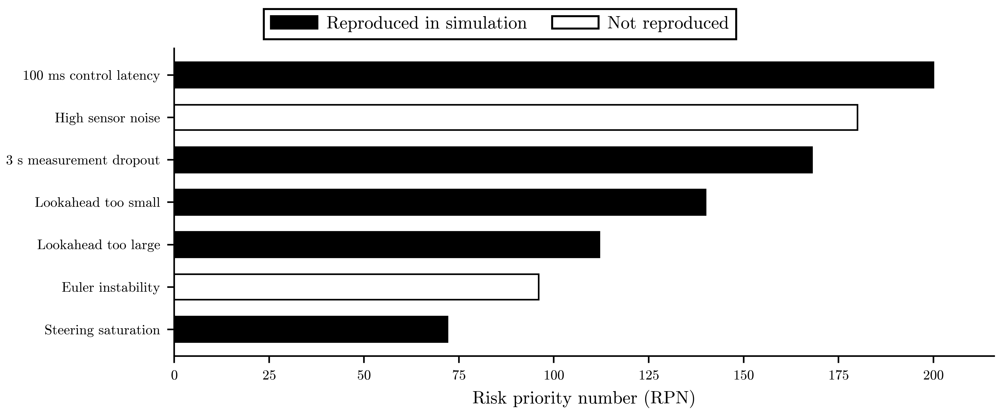
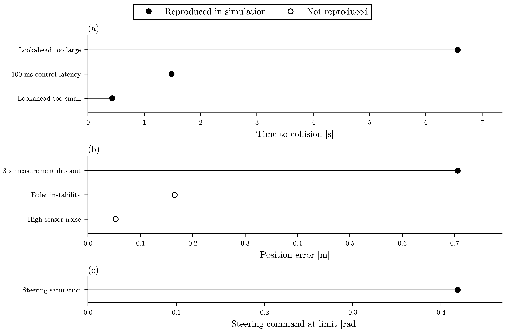

# Failure-Mode FMEA

## Objective

Reproduce controller, estimator, numerical, latency, and actuator failures and document detection signals plus mitigations.

## FMEA Table

| scenario | category | reproduced | detection_signal | severity_1_to_10 | occurrence_1_to_10 | detectability_1_to_10 | rpn | mitigation |
| --- | --- | --- | --- | --- | --- | --- | --- | --- |
| latency_100ms | latency | True | collision at 1.484 s | 8 | 5 | 5 | 200 | Timestamp commands, reduce delay, and add delay compensation. |
| sensor_noise_high | noise | False | EKF high-noise position RMSE 0.053 m | 6 | 6 | 5 | 180 | Tune measurement covariance from sensor specs and reject outliers. |
| measurement_dropout_3s | dropout | True | EKF dropout position RMSE 0.706 m | 7 | 4 | 6 | 168 | Detect stale measurements and slow or stop until updates recover. |
| bad_lookahead_small | controller | True | collision at 0.432 s | 7 | 5 | 4 | 140 | Use the sweep-selected baseline lookahead and steering-effort gates. |
| bad_lookahead_large | controller | True | collision at 6.566 s | 7 | 4 | 4 | 112 | Bound lookahead by map curvature and validate max CTE. |
| euler_instability | numerics | False | no failure, rms CTE=0.166 m | 8 | 4 | 3 | 96 | Use RK4 and keep timestep convergence gates in CI. |
| steering_saturation | actuator | True | command steer dwell at limit 0.419 rad | 8 | 3 | 3 | 72 | Monitor steering limit dwell time and lower speed when saturated. |

## Figures

Simulator output, F1TENTH Gym, failure-mode screen. 100 ms control latency carries the highest risk priority (RPN 200). RPN = severity × occurrence × detectability, each scored 1 to 10. Filled bars: failure reproduced in simulation; hollow bars: not reproduced. Scores, highest first: 100 ms control latency 200 = 8 × 5 × 5; High sensor noise 180 = 6 × 6 × 5; 3 s measurement dropout 168 = 7 × 4 × 6; Lookahead too small 140 = 7 × 5 × 4; Lookahead too large 112 = 7 × 4 × 4; Euler instability 96 = 8 × 4 × 3; Steering saturation 72 = 8 × 3 × 3. Source: runs/failure_mode_fmea/results.csv.
[Caption file](figures/fmea_rpn_bar.caption.md).

Simulator output, F1TENTH Gym, failure-mode screen. Lookahead and latency faults collide within 6.6 s; noise and dropout show only as EKF position error. Each failure mode has its own detection signal, so each unit gets its own panel: (a) detected as a collision: Lookahead too small 0.432 s, 100 ms control latency 1.48 s, Lookahead too large 6.57 s; (b) detected as tracking or estimate error: High sensor noise 0.0527 m, Euler instability 0.166 m, 3 s measurement dropout 0.706 m; (c) detected as steering dwell at the limit: Steering saturation 0.419 rad. Filled markers: failure reproduced in simulation; hollow markers: not reproduced. Source: runs/failure_mode_fmea/results.csv.
[Caption file](figures/fmea_detection_signals.caption.md).
