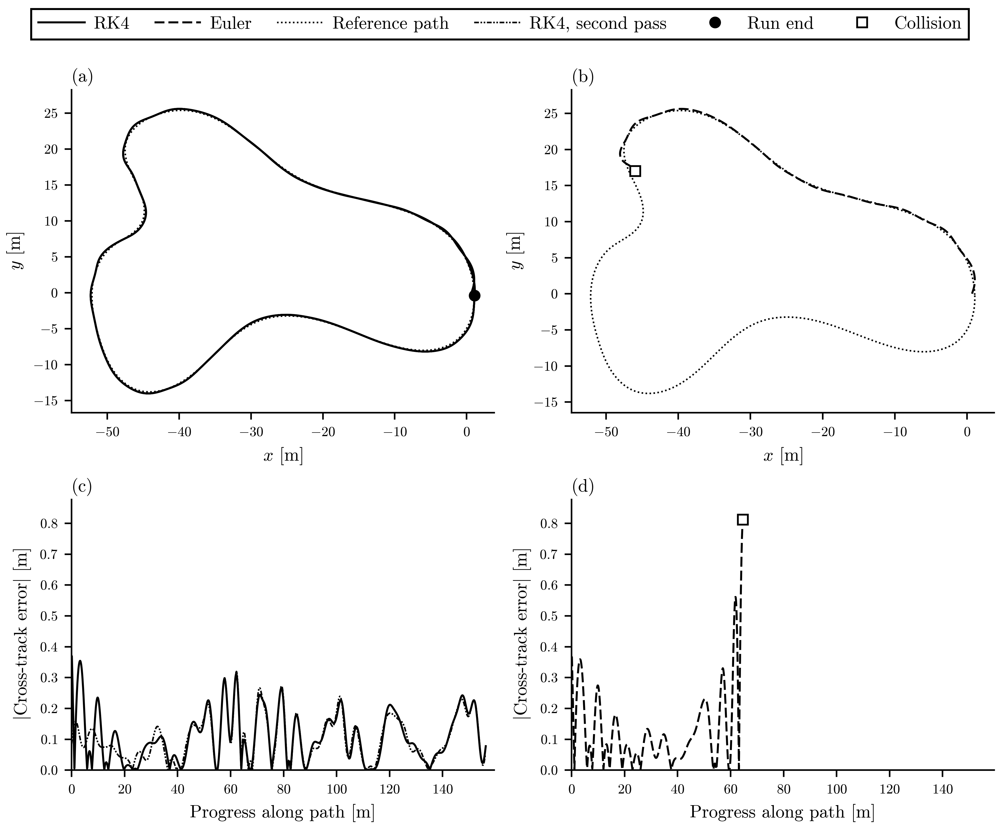
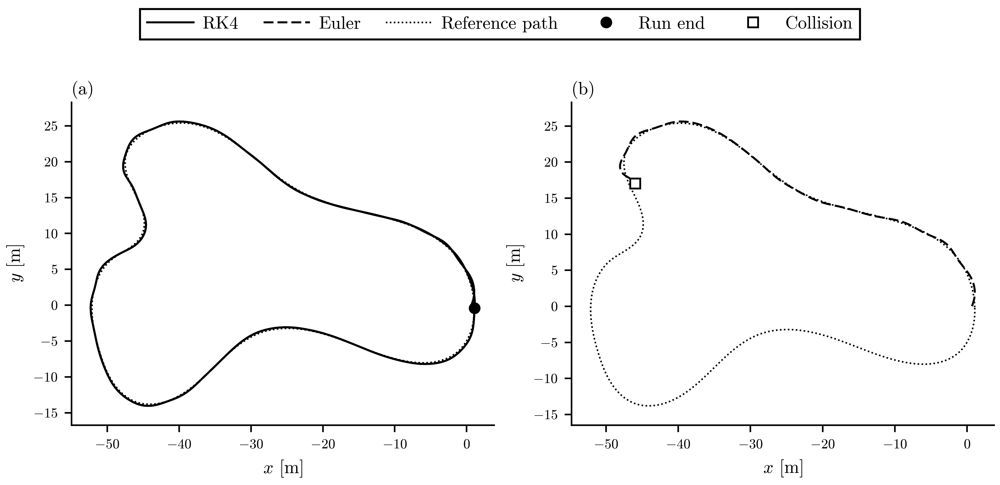
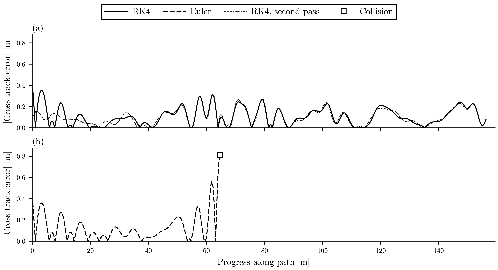
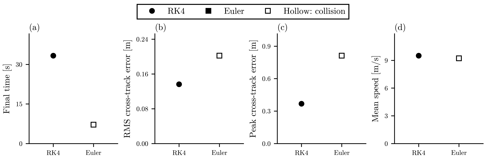

# F1TENTH Gym First Run

## Purpose

This run establishes a reproducible, headless F1TENTH Gym baseline using the existing pure pursuit controller on `examples/example_map`.

This is not yet the derived bicycle-model comparison. The derived-model vs Gym overlay will be added in the next experiment.

## Setup

```bash
conda env create -f environment.yml
conda activate f1tenth-gym
pip install --no-build-isolation --no-deps gym==0.19.0
pip install --force-reinstall "pyglet<1.5"
pip install --no-build-isolation --no-deps -e .
```

## Reproduce

```bash
python experiments/run_scripted_lap.py
python experiments/plot_integrator_comparison.py
python experiments/validate_first_run.py
```

## Artifacts

- Telemetry: `runs/first_lap/telemetry.csv`
- Metadata: `runs/first_lap/metadata.json`
- Main integrator comparison figure: `reports/figures/first_integrator_comparison.png`
- Trajectory figure: `reports/figures/integrator_trajectory_overlay.png`
- Tracking error figure: `reports/figures/integrator_tracking_error_vs_progress.png`
- Summary metrics figure: `reports/figures/integrator_summary_metrics.png`

### Improved integrator comparison figure



Panels (a) and (b): RK4 and Euler trajectories on the example map, with the reference path dotted. Panels (c) and (d): absolute cross-track error along the path for RK4 and Euler, on the same axes. A filled circle marks the end of a run at the Gym's normal stop; a hollow square marks a collision. Euler collides after 7.14 s, 64.7 m along the path; RK4 runs to the Gym's completed lap stop at 33.3 s. RK4: final time 33.290 s, RMS cross-track error 0.136 m, peak 0.368 m, mean speed 9.506 m/s; Euler: final time 7.140 s, RMS cross-track error 0.202 m, peak 0.812 m, mean speed 9.221 m/s. Simulator output, F1TENTH Gym. One closed-loop run per integrator on the example map with the same waypoints and pure-pursuit controller; only the integrator differs. RK4 is solid and Euler dashed. The RK4 second pass is dash-dot. The Gym stops a completed run after 2 passes of the path, so RK4 progress wraps once. This is an integrator sensitivity check, not a derived bicycle-model comparison; one deterministic run per integrator, so there are no error bars. Sources: runs/first_lap/telemetry.csv and examples/example_waypoints.csv.
[Caption file](figures/first_integrator_comparison.caption.md).

### Supporting detail figures



Panel (a): RK4 trajectory; panel (b): Euler trajectory, both on the example map with the reference path dotted and the same axes. A filled circle marks the end of the run at the Gym's normal stop; a hollow square marks a collision. Euler collides after 7.14 s, 64.7 m along the path; RK4 runs to the Gym's completed lap stop at 33.3 s. Simulator output, F1TENTH Gym. One closed-loop run per integrator on the example map with the same waypoints and pure-pursuit controller; only the integrator differs. RK4 is solid and Euler dashed. The Gym stops a completed run after 2 passes of the path, so RK4 progress wraps once. This is an integrator sensitivity check, not a derived bicycle-model comparison; one deterministic run per integrator, so there are no error bars. Sources: runs/first_lap/telemetry.csv and examples/example_waypoints.csv.
[Caption file](figures/integrator_trajectory_overlay.caption.md).



Absolute cross-track error along the path for RK4 (a) and Euler (b), on the same axes. The hollow square marks the Euler collision. Euler collides after 7.14 s, 64.7 m along the path; RK4 runs to the Gym's completed lap stop at 33.3 s. Simulator output, F1TENTH Gym. One closed-loop run per integrator on the example map with the same waypoints and pure-pursuit controller; only the integrator differs. RK4 is solid and Euler dashed. The RK4 second pass is dash-dot. The Gym stops a completed run after 2 passes of the path, so RK4 progress wraps once. This is an integrator sensitivity check, not a derived bicycle-model comparison; one deterministic run per integrator, so there are no error bars. Sources: runs/first_lap/telemetry.csv and examples/example_waypoints.csv.
[Caption file](figures/integrator_tracking_error_vs_progress.caption.md).



Per-run summary metrics: (a) final time, (b) RMS cross-track error, (c) peak cross-track error and (d) mean speed, for RK4 (circles) and Euler (squares). A filled marker is a run that ended at the Gym's normal stop; a hollow marker is a run that ended in a collision. Euler ends earlier with higher RMS and peak tracking error. RK4: final time 33.290 s, RMS cross-track error 0.136 m, peak 0.368 m, mean speed 9.506 m/s; Euler: final time 7.140 s, RMS cross-track error 0.202 m, peak 0.812 m, mean speed 9.221 m/s. Simulator output, F1TENTH Gym. One closed-loop run per integrator on the example map with the same waypoints and pure-pursuit controller; only the integrator differs. The Gym stops a completed run after 2 passes of the path, so RK4 progress wraps once. This is an integrator sensitivity check, not a derived bicycle-model comparison; one deterministic run per integrator, so there are no error bars. Sources: runs/first_lap/telemetry.csv and examples/example_waypoints.csv.
[Caption file](figures/integrator_summary_metrics.caption.md).

## First Results

| Integrator | Termination | Lap time (s) | Collision | RMS CTE (m) | Max abs CTE (m) | Mean speed (m/s) |
| --- | --- | ---: | ---: | ---: | ---: | ---: |
| RK4 | completed_lap | 33.29 | 0 | 0.136 | 0.368 | 9.51 |
| Euler | collision | 7.15 | 1 | 0.202 | 0.812 | 9.22 |

## Notes

- The first plot is an integrator sensitivity check: RK4 vs Euler inside the existing F1TENTH Gym plant.
- Telemetry includes command, pose, yaw rate, estimated acceleration, nearest waypoint, progress, CTE, lap state, collision state, and termination reason.
- Later large sweeps should use separate run directories; only `runs/first_lap/` is intended as the frozen first evidence run.
